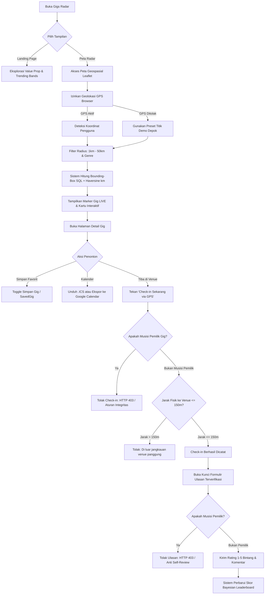

# Alur & Flowchart Pengguna — Gigs Radar
**Platform Geospasial Live Music Tracker Kota Depok**  
*Tugas Proyek Akhir (TPA) DDP1 Fasilkom UI Gasal 2026/2027 — Diadaptasi dari Arsitektur Xplor.in (STACK 2026)*

---

## 1. Ikhtisar Alur Pengguna (User Journey)

Gigs Radar memfasilitasi interaksi dua sisi (*two-sided platform*) dalam ekosistem musik panggung indie di Kota Depok:
1. **Audiens / Penonton**: Menemukan gig live music terdekat, menyaring radius geospasial, menyimpan jadwal, sinkronisasi kalender (.ics / Google Calendar), melakukan verifikasi kehadiran fisik via GPS (geofence $\le 150\text{ m}$), dan memberikan ulasan terverifikasi.
2. **Musisi / Band**: Mengelola identitas panggung, mendaftarkan titik venue dengan deteksi duplikasi spasial ($50\text{ m}$), menjadwalkan penampilan bebas bentrok, mengaktifkan status LIVE via GPS saat tiba di panggung, memperpanjang durasi ($+30\text{ menit}$), dan memantau analitik kehadiran audiens.

---

## 2. Flowchart Pengguna: Audiens / Penonton



---

## 3. Flowchart Pengguna: Musisi / Band

```mermaid
graph TD
    AA[Registrasi Akun Peran: Musisi / Band] --> BB[Lengkapi Profil Panggung: Nama, Genre, Instagram, Foto]
    BB --> CC[Akses Dashboard Band]
    
    CC --> DD{Pilih Operasi Panggung}
    
    DD -->|Daftarkan Venue| EE[Buka Form Tambah Venue]
    EE --> FF[Klik Titik Peta untuk Ambil Lat & Lng]
    FF --> GG{Deteksi Duplikasi Spasial Radius <= 50m?}
    GG -->|Ada Venue Mirip| HH[Tampilkan Peringatan Venue Duplikat]
    HH -->|Konfirmasi Beda Entitas| II[Simpan Titik Venue Baru]
    GG -->|Jarak > 50m| II
    
    DD -->|Jadwalkan Gig| JJ[Buka Form Buat Gig]
    JJ --> KK[Pilih Venue, Judul, Waktu Mulai & Selesai]
    KK --> LL{Cek Jadwal Bentrok Band?}
    LL -->|Jadwal Beririsan| MM[Validasi Gagal: Jadwal Tumpang Tindih]
    LL -->|Bebas Bentrok| NN[Jadwal Gig Dipublikasikan]
    
    NN --> OO[Hari Penampilan: Tiba di Venue]
    OO --> PP[Tekan 'Go Live GPS' di Dashboard]
    PP --> QQ{Waktu Sekarang dalam [Mulai - 30m, Selesai]?}
    QQ -->|Di Luar Jendela| RR[Tolak: Belum Waktunya atau Sudah Selesai]
    QQ -->|Dalam Jendela| SS{GPS Musisi <= 150m dari Venue?}
    SS -->|Jarak > 150m| TT[Tolak: Musisi Belum Berada di Venue]
    SS -->|Jarak <= 150m| UU[Status Gig Berubah Menjadi LIVE di Peta]
    
    UU --> VV{Penampilan Selesai / En-core?}
    VV -->|+30 Menit| WW{Pernah Diperpanjang Sebelumnya?}
    WW -->|Sudah Pernah| XX[Tolak: Maksimal 1 Kali Perpanjangan]
    WW -->|Belum Pernah| YY[Waktu Selesai Ditambah 30 Menit]
    VV -->|Tutup Gig| ZZ[Status Gig Menjadi SELESAI]
    
    ZZ --> AAA[Pantau Kurva Kehadiran di Dashboard Chart.js]
```

---

## 4. Penjelasan Aturan Integritas Data & Anti-Slop

1. **Anti Self-Checkin (Constraint Geospasial)**:
   Musisi pemilik pertunjukan secara teknis dilarang mencatat kehadiran check-in pada gig buatannya sendiri. Sistem merespons dengan HTTP 403 (`HttpResponseForbidden`) dan pesan penolakan ramah di UI.
2. **Anti Self-Review (Integritas Algoritma Bayesian)**:
   Musisi dilarang memberi ulasan pada band miliknya sendiri. Rating hanya dapat diberikan oleh akun penonton yang telah terverifikasi check-in fisik di venue saat acara berlangsung.
3. **Lazy State Evaluation**:
   Status LIVE dievaluasi secara cerdas saat ada permintaan pembacaan data. Jika gig melewati batas waktu selesai ditambah batas toleransi 30 menit, status otomatis diperbarui menjadi `SELESAI` tanpa ketergantungan cronjob eksternal.
4. **Pencegahan Spam Venue (50m Deduplication)**:
   Saat musisi menambahkan venue baru, algoritma Bounding-Box dan Haversine mendeteksi apakah telah ada venue lain dalam radius 50 meter. Pengguna diberikan peringatan dan wajib memberikan konfirmasi manual jika venue memang berbeda.
