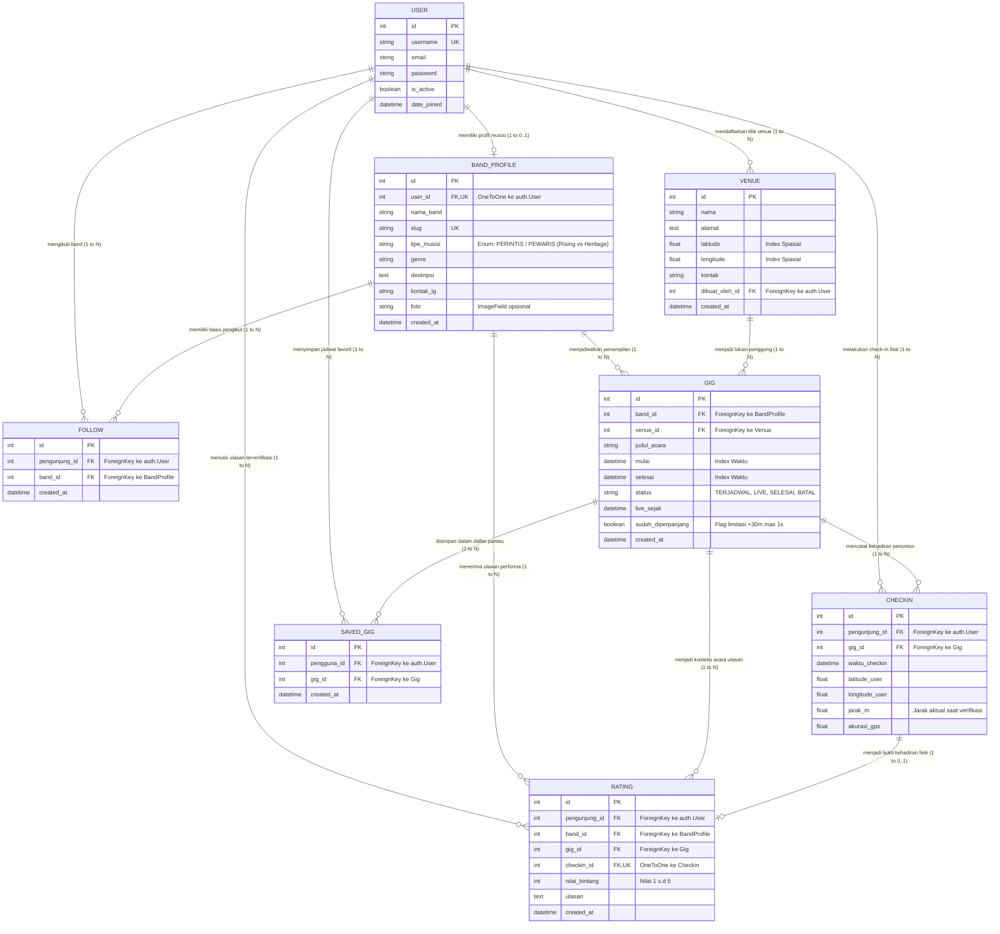

# Entity Relationship Diagram (ERD) — Gigs Radar
**Spesifikasi Model Data Relasional & Aturan Integritas**  
*Tugas Proyek Akhir (TPA) DDP1 Fasilkom UI Gasal 2026/2027*

---

## 1. Diagram Relasi Entitas (Mermaid ERD)

---

## 2. Rincian Tabel Relasional & Indeks

### A. Tabel `accounts_bandprofile`
* Relasi: `OneToOneField` ke `auth.User` (cascade on delete).
* Slugification: Kolom `slug` dibuat otomatis dari `nama_band` menggunakan fungsi `slugify()` dengan penjamin keunikan numerik jika terdapat nama panggung serupa.
* Properti Terhitung:
  - `total_pengikut`: Menghitung jumlah relasi pada tabel `interactions_follow`.
  - `skor_popularitas`: Mengaplikasikan rumus Bayesian Average $\frac{v}{v+m} \cdot R + \frac{m}{v+m} \cdot C + \log_{10}(1+F)$.

### B. Tabel `venues_gigs_venue`
* Relasi: `ForeignKey` ke `auth.User` (penulis/musisi pendaftar venue, `SET_NULL`).
* Optimasi Geospasial: Kolom `latitude` dan `longitude` diberi indeks komposit `Index(fields=['latitude', 'longitude'])` untuk query cepat Bounding-Box SQL sebelum kalkulasi Haversine presisi.
* Spatial Deduplication: Pencegahan pendaftaran titik ganda dengan deteksi radius $\le 50\text{ meter}$.

### C. Tabel `venues_gigs_gig`
* Relasi:
  - `band_id` (`ForeignKey` ke `BandProfile`, `CASCADE`).
  - `venue_id` (`ForeignKey` ke `Venue`, `PROTECT`).
* Optimasi Indeks:
  - `Index(fields=['status', 'mulai'])`: Filter cepat gig berstatus LIVE dan waktu tayang.
  - `Index(fields=['mulai', 'selesai'])`: Validasi pencegahan jadwal tumpang tindih (*overlap prevention*).
* Lazy State Calculation:
  - Menghitung status deterministik tanpa cronjob via `evaluasi_status_live()`.
  - Properti `crowd_heat`: Mengelompokkan total check-in menjadi **Sepi** ($< 10$), **Hangat** ($10 - 29$), atau **Ramai** ($\ge 30$).

### D. Tabel `interactions_checkin`
* Relasi: `pengunjung_id` ke `auth.User` dan `gig_id` ke `Gig`.
* Konstrain Integritas:
  - `unique_together = ('pengunjung', 'gig')`: Mencegah duplikasi check-in oleh pengguna yang sama pada satu gig.
  - Anti Self-Checkin: Musisi dilarang check-in di gig miliknya sendiri (diverifikasi pada tingkat service layer dan model clean).
  - Geofence Verification: Koordinat GPS pengguna wajib $\le 150\text{ meter}$ dari venue panggung.

### E. Tabel `interactions_rating`
* Relasi:
  - `pengunjung_id` ke `auth.User`.
  - `band_id` ke `BandProfile`.
  - `gig_id` ke `Gig`.
  - `checkin_id` (`OneToOneField` ke `Checkin`): Menjamin bahwa ulasan hanya dapat ditulis jika terdapat rekaman check-in fisik yang sah (*verified attendee attendance*).
* Konstrain Integritas:
  - Anti Self-Review: Musisi dilarang mereview band sendiri (HTTP 403).
  - Rentang Bintang: $1 \le \text{nilai\_bintang} \le 5$.
  - `unique_together = ('pengunjung', 'gig')`: Maksimal 1 ulasan per pengguna per acara.

### F. Tabel `interactions_follow`
* Relasi: `pengunjung_id` ke `auth.User` dan `band_id` ke `BandProfile`.
* Konstrain: `unique_together = ('pengunjung', 'band')`. Musisi dilarang mem-follow profil band sendiri.

### G. Tabel `interactions_savedgig`
* Relasi: `pengguna_id` ke `auth.User` dan `gig_id` ke `Gig`.
* Konstrain: `unique_together = ('pengguna', 'gig')`. Mengakomodasi fitur simpan acara sesuai spesifikasi Xplor.in `saved_events`.

