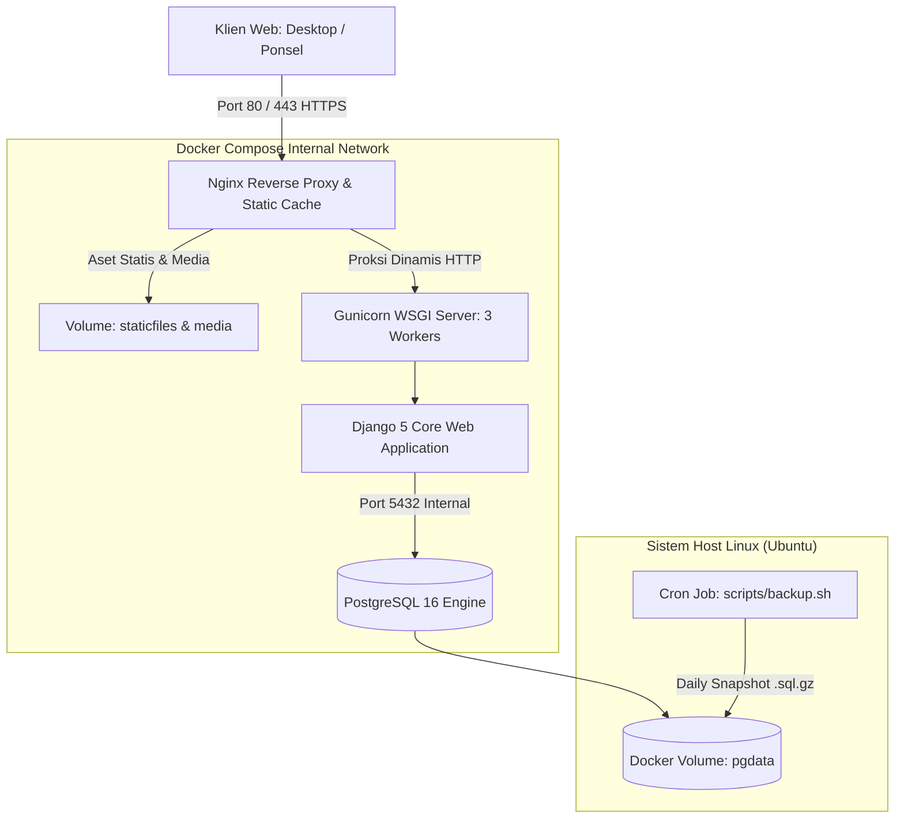

# Panduan Lengkap Self-Hosted Server & Production Deployment — Gigs Radar

Panduan ini ditujukan bagi Administrator Sistem & Pengembang untuk meluncurkan platform **Gigs Radar** pada server sendiri (VPS seperti DigitalOcean, Hetzner, Linode, AWS EC2, Alibaba Cloud, atau Bare-Metal Server) dengan kebebasan penuh mengelola backend, basis data, dan konfigurasi jaringan.

---

## 1. Topologi Arsitektur Server Mandiri



---

## 2. Prasyarat Server VPS
- **Sistem Operasi**: Ubuntu 22.04 LTS atau 24.04 LTS (Rekomendasi).
- **Spesifikasi Minimal**: 1 vCPU, 1 GB RAM, 20 GB SSD.
- **Spesifikasi Rekomendasi**: 2 vCPU, 2 GB RAM, 40 GB SSD.
- **Port Terbuka**: Port 22 (SSH), Port 80 (HTTP), Port 443 (HTTPS).

---

## 3. Langkah-demi-Langkah Instalasi Server

### Langkah 1: Persiapan Server & Instalasi Docker
Masuk ke VPS via SSH dan jalankan perintah berikut:
```bash
# 1. Perbarui repositori paket
sudo apt update && sudo apt upgrade -y

# 2. Instal dependensi dasar
sudo apt install -y curl git ufw fail2ban

# 3. Instal Docker Engine & Docker Compose Plugin
curl -fsSL https://get.docker.com -o get-docker.sh
sudo sh get-docker.sh
sudo usermod -aG docker $USER

# 4. Aktifkan firewall UFW
sudo ufw allow 22/tcp
sudo ufw allow 80/tcp
sudo ufw allow 443/tcp
sudo ufw enable
```
*(Logout dan login kembali agar izin grup docker aktif).*

---

### Langkah 2: Kloning Repositori & Konfigurasi Lingkungan
```bash
# 1. Kloning repositori proyek
git clone <URL_REPOSITORI_ANDA> gigsradar
cd gigsradar

# 2. Salin template environment production
cp .env.production.example .env

# 3. Buka dan sesuaikan variabel rahasia
nano .env
```

Contoh konfigurasi `.env`:
```ini
DEBUG=False
SECRET_KEY=kunci_rahasia_acak_yang_sangat_panjang_dan_aman_skala_enterprise
ALLOWED_HOSTS=gigsradar.id,www.gigsradar.id,103.123.45.67
CSRF_TRUSTED_ORIGINS=https://gigsradar.id,https://www.gigsradar.id

POSTGRES_DB=gigsradar_db
POSTGRES_USER=gigsuser
POSTGRES_PASSWORD=password_database_rahasia_anda_disini
```

---

### Langkah 3: Menjalankan Container 1-Klik
Cukup jalankan Docker Compose:
```bash
# 1. Bangun image dan jalankan container secara daemon (background)
docker compose up -d --build

# 2. Terapkan migrasi skema basis data
docker compose exec web python manage.py migrate

# 3. Kumpulkan file statis (CSS, JS, Asset)
docker compose exec web python manage.py collectstatic --noinput

# 4. (Opsional) Muat data demo musisi Perintis & Pewaris Depok
docker compose exec web python manage.py seed_demo

# 5. Buat akun superuser admin
docker compose exec web python manage.py createsuperuser
```

Periksa status container:
```bash
docker compose ps
```
Semua container (`gigsradar_db`, `gigsradar_web`, `gigsradar_nginx`) harus berstatus `Up (healthy)`.

---

### Langkah 4: Verifikasi Healthcheck Sistem
Uji endpoint kesehatan sistem mandiri:
```bash
curl http://localhost/healthz
```
Output yang diharapkan:
```json
{
  "status": "healthy",
  "database": "ok",
  "framework": "Django 5.2.19",
  "python": "3.12.x",
  "timestamp": "2026-11-12T...",
  "service": "Gigs Radar Platform"
}
```

---

### Langkah 5: Pemasangan Sertifikat SSL Gratis (Let's Encrypt / Certbot)
Untuk mengamankan HTTPS domain publik Anda:
```bash
# 1. Instal Certbot
sudo apt install -y certbot

# 2. Hentikan container Nginx sementara untuk validasi standalone
docker compose stop nginx

# 3. Ajukan sertifikat SSL
sudo certbot certonly --standalone -d yourdomain.com -d www.yourdomain.com

# 4. Mount sertifikat ke direktori nginx (atau aktifkan di nginx/conf.d/default.conf)
# 5. Nyalakan kembali Nginx
docker compose start nginx
```

---

## 4. Pemeliharaan Operasional (Operations Runbook)

### A. Deploy Update Baru (Zero-Downtime)
Gunakan skrip otomatis yang telah disediakan:
```bash
chmod +x scripts/deploy.sh
./scripts/deploy.sh
```

### B. Backup Database Otomatis
Jalankan manual:
```bash
chmod +x scripts/backup.sh
./scripts/backup.sh
```
Atau jadwalkan via `crontab -e` setiap pukul 02:00 pagi:
```cron
0 2 * * * /home/ubuntu/gigsradar/scripts/backup.sh >> /var/log/gigsradar_backup.log 2>&1
```

### C. Pemantauan Log Real-Time
```bash
# Memantau log aplikasi web Django/Gunicorn
docker compose logs -f web

# Memantau log akses Nginx
docker compose logs -f nginx

# Memantau log database PostgreSQL
docker compose logs -f db
```

---
*Gigs Radar — Siap Berlayar untuk Publikasi Skala Penuh.*
